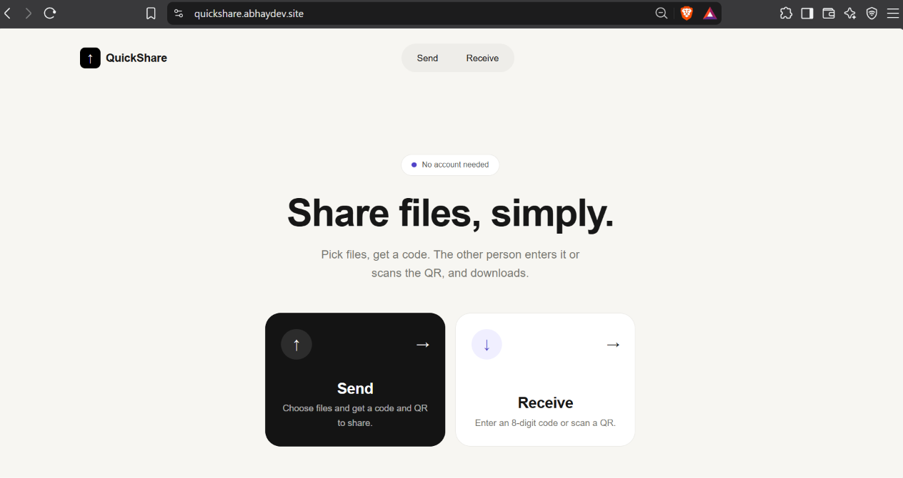
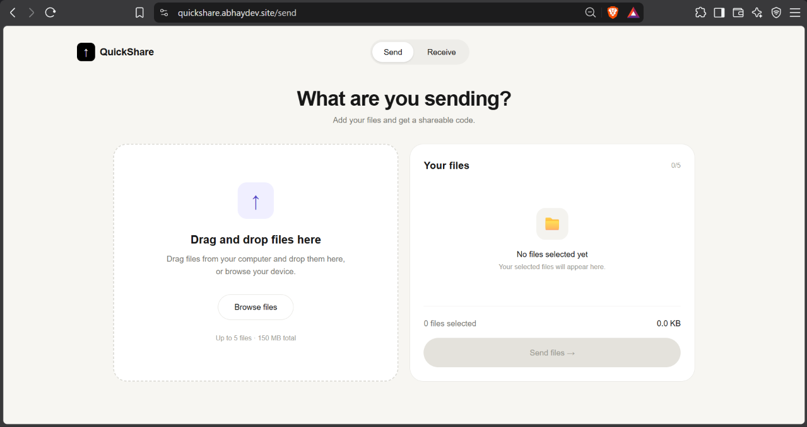
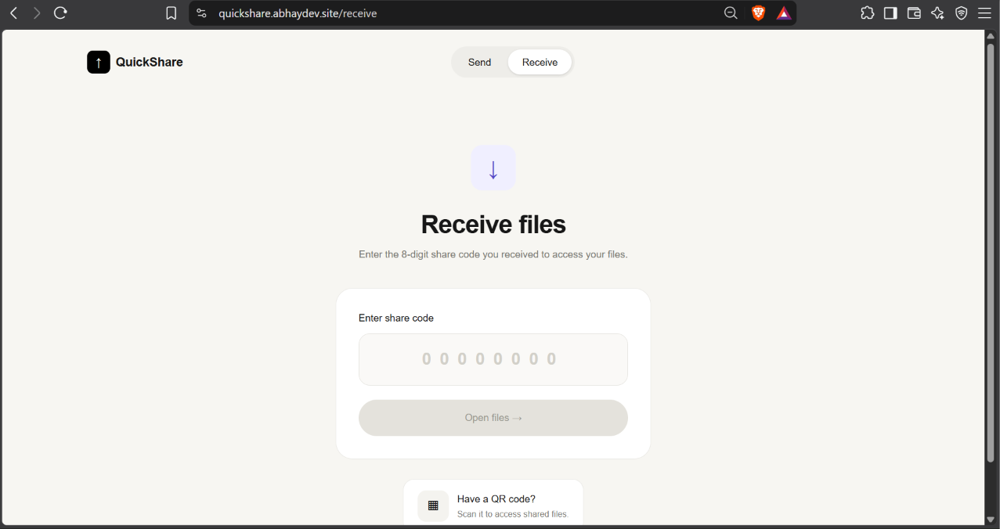
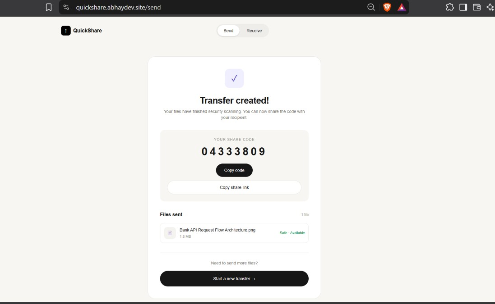
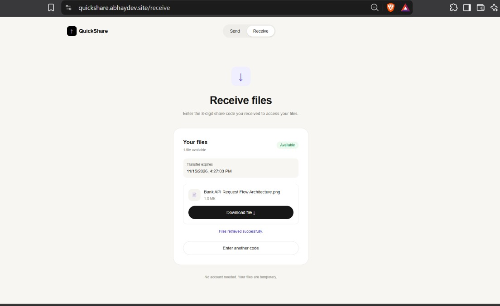
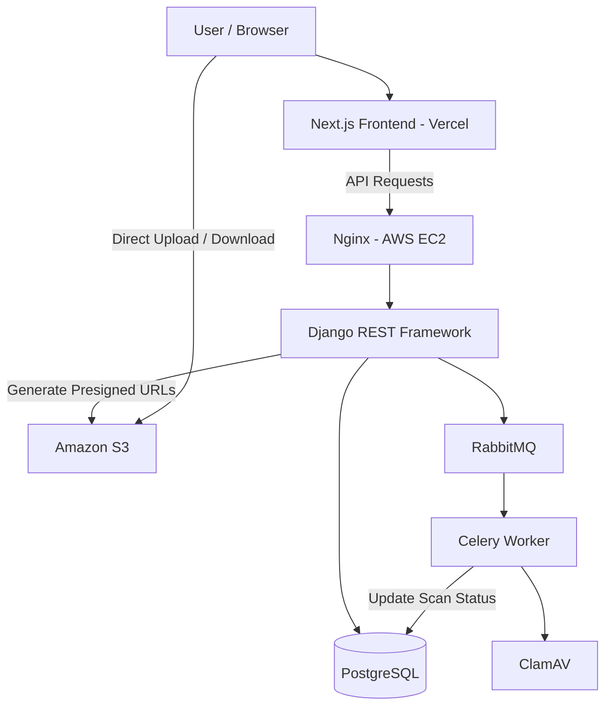

# QuickShare

<p align="center">
  <strong>Simple. Secure. Seamless file sharing.</strong>
  <br />
  Transfer files between devices using a simple shareable code.
</p>

<p align="center">
  <a href="https://quickshare.abhaydev.site">
    
  </a>
</p>

---

## Screenshots

<p align="center">
  
  <br />
  <em>Landing Page</em>
</p>

<p align="center">
  
  
</p>

<p align="center">
  
  
</p>

---

## About

QuickShare is a full-stack file-sharing web application that makes transferring files between devices simple and convenient.

Users can upload files, receive a unique shareable code, and download those files from another device.

Files are uploaded directly to a private Amazon S3 bucket using presigned URLs and undergo asynchronous malware scanning before becoming available for download.

## Features

- **Cross-device file sharing** — Transfer files between computers and mobile devices.
- **Shareable codes** — Share files using a unique transfer code.
- **Direct S3 uploads** — Upload files directly to private AWS S3 storage using presigned URLs.
- **Malware scanning** — Scan uploaded files asynchronously using ClamAV.
- **Time-limited transfers** — Transfers expire after a configured period.
- **Background processing** — Handle scanning and background tasks using Celery and RabbitMQ.

## Architecture




## Backend API Documentation

Explore the backend REST API, review available endpoints, request parameters, and response schemas.

<p align="center">
  <a href="https://api.abhaydev.site/api/docs/">
    
  </a>
</p>

**API Docs:** https://api.abhaydev.site/api/docs/


## Tech Stack

<table>
  <tr>
    <th align="left">Category</th>
    <th align="left">Technology</th>
  </tr>
  <tr><td>Frontend</td><td>Next.js, TypeScript</td></tr>
  <tr><td>Backend</td><td>Django, Django REST Framework</td></tr>
  <tr><td>Database</td><td>PostgreSQL</td></tr>
  <tr><td>Object Storage</td><td>Amazon S3</td></tr>
  <tr><td>Background Processing</td><td>Celery, RabbitMQ</td></tr>
  <tr><td>Malware Scanning</td><td>ClamAV</td></tr>
  <tr><td>Containerization</td><td>Docker, Docker Compose</td></tr>
  <tr><td>Reverse Proxy</td><td>Nginx</td></tr>
  <tr><td>Backend Hosting</td><td>AWS EC2</td></tr>
  <tr><td>Frontend Hosting</td><td>Vercel</td></tr>
  <tr><td>HTTPS</td><td>Let's Encrypt</td></tr>
</table>


## Local Development Setup

Follow these instructions to get a local copy of QuickShare running on your machine.

### Prerequisites

Make sure you have the following installed:

- [Git](https://git-scm.com/)
- [GitHub Account](https://github.com/)

### 1. Clone the Repository

You can either fork the repository to your own GitHub account or clone it directly.

**Option A: Fork the Repository**

1. Visit the [QuickShare GitHub Repository](https://github.com/abhayrajsingh099/QuickShare).
2. Click the **Fork** button in the top-right corner.
3. Select your GitHub account to create a copy of the repository.

Clone your fork:

```bash
git clone https://github.com/<your-username>/QuickShare.git
```

**Option B: Clone Directly**

If you only want to explore or run the project locally:

```bash
git clone https://github.com/abhayrajsingh099/QuickShare.git
```

### 2. Navigate to the Project Directory

```bash
cd QuickShare
```

The repository contains separate frontend and backend applications:

```text
QuickShare/
├── frontend/
├── backend/
├── docker/
├── docs/
└── README.md
```

Continue with the frontend and backend setup instructions below.

### 3. Frontend Setup

**Prerequisites**

- [Node.js](https://nodejs.org/) (LTS version recommended)
- npm (included with Node.js)

**Step 1: Navigate to the frontend directory**

```bash
cd frontend
```

**Step 2: Configure environment variables**

The frontend requires the backend API URL to communicate with the Django application.

Copy the example environment file:

```bash
cp .envs/.env.example .env.local
```

Open `.env.local` and configure:

```env
NEXT_PUBLIC_API_URL=http://localhost:8080/api
```

This URL assumes the backend is running locally on port `8000`.

**Step 3: Install dependencies**

```bash
npm install
```

**Step 4: Start the development server**

```bash
npm run dev
```

The frontend will be available at:

http://localhost:3000

**Note:** Make sure the backend is running and accessible at the configured API URL before using API-dependent features.

### 4. Backend Setup

The backend uses Docker Compose to run Django, PostgreSQL, Nginx, RabbitMQ, Celery and ClamAV.

**Prerequisites**

- [Docker Desktop](https://www.docker.com/products/docker-desktop/) (or Docker Engine with Docker Compose)

**Step 1: Configure environment variables**

From the project root, copy the example environment file:

```bash
cp .envs/.env.example .envs/.env.local
```

Open `.envs/.env.local` and configure the required values.

| Variable | Description |
|---|---|
| `DJANGO_SECRET_KEY` | Django development secret key |
| `POSTGRES_DB` | PostgreSQL database name |
| `POSTGRES_USER` | PostgreSQL username |
| `POSTGRES_PASSWORD` | PostgreSQL password |
| `AWS_ACCESS_KEY_ID` | AWS access key ID |
| `AWS_SECRET_ACCESS_KEY` | AWS secret access key |
| `AWS_STORAGE_BUCKET_NAME` | S3 bucket name |
| `AWS_S3_REGION_NAME` | AWS region |

RabbitMQ and ClamAV configuration is also included in the example environment file.

**Note:** AWS credentials and a configured S3 bucket are required for file storage operations.

**Step 2: Build and start the backend**

Run the following command from the project root:

```bash
docker compose --env-file .envs/.env.local -f local.yml up --build
```

Docker Compose automatically starts the required services. Database migrations and static file collection are also performed during Django startup.

**Step 3: Access the backend**

Once the containers are running, the backend API is available at:

```text
http://localhost:8080/api/
```

The local API documentation is available at:

```text
http://localhost:8080/api/docs/
```

**Step 4: Stop the backend**

To stop the running containers:

```bash
docker compose --env-file .envs/.env.local -f local.yml down
```

### 5. Connecting the Frontend and Backend

Make sure the frontend environment file (`frontend/.env.local`) contains:

```env
NEXT_PUBLIC_API_URL=http://localhost:8080/api
```

Start the frontend separately using the frontend setup instructions.

The frontend runs at `http://localhost:3000` and communicates with the backend through the local Nginx server.